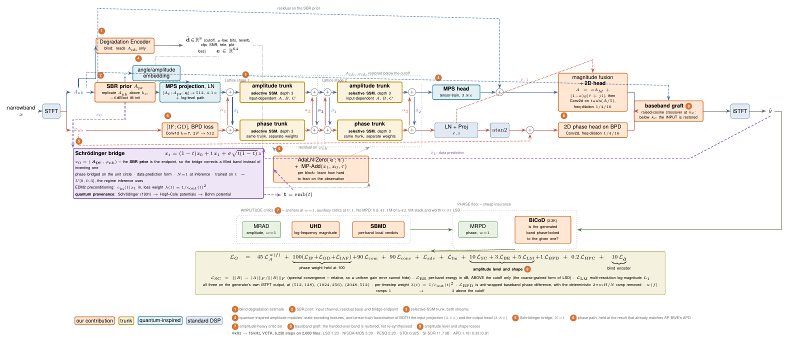

# BWE-SB

Degradation-aware speech bandwidth extension that predicts wideband amplitude and phase in parallel, trained as a Schrödinger bridge and run as a single forward pass. The generator uses a selective state space trunk in both streams, bridges from a spectral band replication prior instead of the raw input, infers the degradation blindly from the narrowband signal, and restores the band it was handed through a crossover graft. Amplitude-side modules use tensor-train factorisation.



The repository trains on VCTK by default and evaluates on nine degradation banks, a held-out corpus of your choice, and the Vibravox in-ear corpus for a cross-sensor test. Every path is a config key or a command line flag so it can be pointed at a different dataset.

## Results

4 kHz to 16 kHz on the official VCTK test speakers, 6,250 steps on 2,000 training files, checkpoint chosen on 200 held-out training speakers' files, test set touched once.

| | LSD | LSD-HF | NISQA-MOS | PESQ | STOI | SI-SDR | APD-IP / GD / IAF |
|---|---|---|---|---|---|---|---|
| BWE-SB (this run) | 1.20 | 1.37 | 3.39 | 2.20 | 0.925 | 11.7 | 1.18 / 0.33 / 0.91 |
| AP-BWE (paper, 500k steps) | 0.96 | | 3.86 | 2.55 | 0.94 | 13.4 | |
| UDSS-BWE (paper) | 0.96 | | 4.35 | 2.56 | 0.94 | 13.2 | |
| unprocessed 4 kHz input | 4.67 | 5.39 | 2.79 | 1.15 | 0.55 | 12.7 | |

The published rows train on all 40,936 files for 50 to 500k steps. Our APD columns use a mean absolute reduction; the `awpd_*` columns the code also writes use AP-BWE's root mean square reduction and are the ones to put next to its Table II.

Zero-shot on Vibravox (in-ear microphone to headset reference, 84 pairs, French, unseen speakers): LSD-HF 1.50 against 1.37 in-domain. Waveform metrics do not transfer because the two microphones' signals correlate at only 0.48 before any processing.

## Install

```
pip install -r requirements.txt
git clone --depth 1 https://github.com/gabrielmittag/NISQA.git   # optional, for NISQA-MOS
```

PyTorch and torchaudio are not pinned; any recent CUDA build works. `pesq` and `pystoi` need a C compiler.

## Data

The trainer reads `<speaker>/<file>.wav` under one directory plus three id lists. For VCTK with AP-BWE's official split:

```
python scripts/make_splits.py --wav-dir /data/VCTK/wav48 \
    --train-list splits/vctk/training.txt --test-list splits/vctk/test.txt \
    --cap 2000 --val-holdout 200 --out work/splits
```

`--cap` subsamples the training list; the validation files are drawn from the official training speakers beyond the cap, so the test speakers stay unseen until the final evaluation. Without the two list flags the script picks speakers at random, which is how you use it on another corpus:

```
python scripts/make_splits.py --wav-dir /data/mycorpus --train-speakers 80 --test-speakers 8 --out work/splits
```

Audio is resampled on the fly, so 48 kHz or 16 kHz sources both work. The narrowband input is made inside the dataset by resampling down to `task.lr_sampling_rate` and back, then degraded by a recipe drawn from `degradation.train_bank`.

## Train

```
python scripts/train.py --config configs/4kto16k.json --tier short \
    --wav-dir /data/VCTK/wav48 --splits work/splits --work work --nisqa-dir NISQA
```

Tiers in the config: `tiny` runs five steps to prove the plumbing, `probe` runs 500 steps and exits through the early-stop path, `short` is 6,250 steps on the capped list, `full` is 100k steps on everything. Any key can be changed from the command line, for example `--set loss.be=5 --set bridge.t_max=0.5`. Runs resume from `ckpt.pt`; the weights with the best validation LSD-HF go to `best.pt` and are what the final evaluation scores.

The step log prints every loss term. `sc` should stay in single digits and the discriminator loss should not slide; the health check at the end raises if any logged value is non-finite or `sc` spikes.

## Evaluate and plot

```
python scripts/plot_results.py --config configs/4kto16k.json --runs work/runs --splits work/splits
python scripts/diagnostics.py --runs work/runs --wav-dir /data/VCTK/wav48 --splits work/splits
python scripts/vibravox.py --runs work/runs --nisqa-dir NISQA
python scripts/cross_dataset.py --runs work/runs --corpus libritts=/data/LibriTTS/test-clean
python scripts/evaluate.py --model work/runs/T_selssm --wavs /data/other/16k --banks sinc unseen R4
```

`plot_results.py` writes the leaderboard, per-bank robustness, the degradation sweeps with the unprocessed input as a baseline, band-wise LSD, spectrograms and error maps, the long-term average spectrum, phase metrics, the ITU-style diagnostics, loss curves and complexity. Figures that compare runs appear once there are two or more run directories.

`diagnostics.py` runs the oracle decomposition, which scores predicted magnitude with true phase and the reverse so you can see which stream limits SI-SDR, and sweeps the bridge step count at inference.

## Layout

```
bwe_sb/
  data/        dataset and STFT (from AP-BWE), degradation recipes, Vibravox pairing
  models/      generator, selective-SSM trunk, bridge, critics
  losses/      amplitude and phase losses
  metrics/     LSD, SI-SDR, phase distances, ITU diagnostics, PESQ, STOI, SQUIM and NISQA hooks
  train.py     training loop
  evaluate.py  scoring a run on a directory or a paired corpus
  report.py    one function per table or figure, sharing a namespace
  config.py    config loading and the experiment dict
configs/       one JSON per task
scripts/       command line entry points
tests/         torch-level checks and the synthetic fixtures the reporting code is tested on
figures/       the architecture figure and its TeX source
splits/vctk/   AP-BWE's official VCTK training and test id lists
```

`python -m tests.test_model` checks that the generator builds, forwards and backwards, that the phase output stays wrapped, that the graft leaves the handed-over band untouched and that the amplitude losses stay bounded on a silent reference. `python -m tests.test_report` builds a synthetic run and renders every figure from it.

## Where the pieces come from

The STFT pair, dataset class, MRAD, MRPD and the anti-wrapping phase losses are from AP-BWE and keep their MIT licence in `LICENSE-APBWE`. The Lattice coupling between streams and the separable convolutions in the bicoherence critic follow CIS-BWE. Each module says in its docstring what it takes from where.

## Citation

If you use this code, please cite the paper and the works it builds on.

```bibtex
@article{bwesb2026,
  title   = {Degradation-Aware Speech Bandwidth Extension with a Schr{\"o}dinger Bridge and Quantum-Inspired Amplitude Modelling},
  author  = {S. Munir},
  year    = {2026},
  note    = {Code: https://github.com/Nezent/BWE-SB}
}

@article{lu2024apbwe,
  title   = {Towards High-Quality and Efficient Speech Bandwidth Extension with Parallel Amplitude and Phase Prediction},
  author  = {Lu, Ye-Xin and Ai, Yang and Du, Hui-Peng and Ling, Zhen-Hua},
  journal = {IEEE/ACM Transactions on Audio, Speech, and Language Processing},
  year    = {2024},
  note    = {arXiv:2401.06387}
}

@inproceedings{tamiti2026cisbwe,
  title     = {CIS-BWE: Chaos-Informed Speech Bandwidth Extension},
  author    = {Tamiti and others},
  booktitle = {Proceedings of ACL},
  year      = {2026},
  note      = {arXiv:2507.15970}
}

@article{tamiti2026udssbwe,
  title  = {UDSS-BWE: Uncertainty- and Decision-Science Inspired Swin Bandwidth Extension},
  author = {Tamiti and others},
  year   = {2026},
  note   = {arXiv:2609.36379}
}

@inproceedings{mittag2021nisqa,
  title     = {NISQA: A Deep CNN-Self-Attention Model for Multidimensional Speech Quality Prediction with Crowdsourced Datasets},
  author    = {Mittag, Gabriel and Naderi, Babak and Chehadi, Assmaa and M{\"o}ller, Sebastian},
  booktitle = {Interspeech},
  year      = {2021}
}

@article{hauret2024vibravox,
  title  = {Vibravox: A Dataset of French Speech Captured with Body-conduction Audio Sensors},
  author = {Hauret, Julien and Olivier, Malo and Joubaud, Thomas and Langrenne, Christophe and Poir{\'e}e, Sarah and Zimpfer, V{\'e}ronique and Bavu, {\'E}ric},
  year   = {2024},
  note   = {arXiv:2407.11828}
}
```

Fill in the author list and venue of the first entry once the paper is out, and the full author lists of the two lab papers from their published versions.

## Licence

MIT, see `LICENSE`. Vendored AP-BWE code is under its own MIT licence in `LICENSE-APBWE`.
